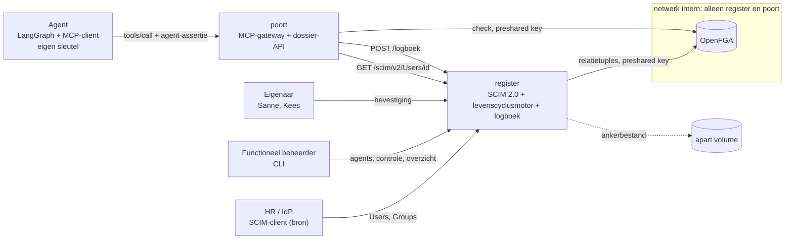

# Identity voor AI-agents: levenscyclus, eigenaarschap en herbeoordeling

[English](README.en.md)

Een AI-agent is een identiteit met een eigenaar en een houdbaarheidsdatum. Deze repo laat zien dat
je een agent dezelfde levenscycluszorg kunt geven als een medewerker: hij wordt geprovisioneerd met
een menselijke eigenaar, een doel, een vervaldatum en een risicoklasse. Hij bestaat alleen zolang
zijn eigenaar hem bevestigt, volgt zijn eigenaar bij een functiewissel en verdwijnt met zijn
eigenaar bij vertrek. Alles wat hij doet en alles wat met hem gebeurt, staat in één controleerbaar
logboek.

Het scenario speelt bij de fictieve gemeente Lindevoort. Alle namen, dossiers en inhoud zijn
verzonnen.


De opname toont `make demo`: vijf scenario's tegen de echte keten en daarna het logboek als bewijs. Opnieuw opnemen: `make opname` (vereist [VHS](https://github.com/charmbracelet/vhs) en ffmpeg).

## Wat dit bewijst

- **Eigenaarschap is afdwingbaar.** Een agent heeft altijd een menselijke eigenaar (geen agent als
  eigenaar). Zonder bevestiging van die eigenaar doet de agent niets, ook niet als de beheerder hem
  net heeft aangemaakt.
- **Toegang volgt de eigenaar.** De agent erft zijn toegang van de teams van zijn eigenaar
  (agent → eigenaar → team → dossier in OpenFGA). Wisselt de eigenaar van team (mover), dan moet
  hij de agent opnieuw bevestigen en verliest de agent het oude team. Vertrekt de eigenaar
  (leaver), dan wordt de agent direct gedeactiveerd, ook midden in een opdracht.
- **Tijd is een harde grens.** Na de vervaldatum of een uitgebleven herbeoordeling weigert de
  poort de agent, nog vóór een controlerun. OpenFGA weigert na de vervaldatum ook zelf, los van de
  poort.
- **De grens ligt buiten het model.** De agent mag gekaapt worden. Een prompt-injectie in een
  dossierbijlage stuurt hem naar een dossier van een ander team; dat strandt op de relatie, niet op
  het oordeel van het model.
- **Eén logboek, controleerbaar.** Levenscyclusgebeurtenissen en toolcalls staan in één hashketen
  met een anker op een apart volume. Een gewijzigd record of een weggelaten staart valt op.

## Architectuur



| Component | Rol |
|---|---|
| `register` | SCIM 2.0-server (RFC 7643/7644) voor medewerkers, teams en agents, met een agentschema-extensie; levenscyclusmotor; beheer-API; geketend logboek; eigenaar van store en model in OpenFGA |
| `openfga` | Relatiegebaseerde autorisatie (`openfga/openfga:v1.22.0`, in-memory, preshared key) |
| `poort` | MCP-gateway vóór de dossier-API. Per toolcall vijf controles: assertie, levenscyclus, tool, relatie, logboek. Pas na het logboekrecord voert hij de tool uit |
| agent | LangGraph-agent met eigen ES256-sleutel; identificeert zich per verzoek met een eenmalige assertie |
| `levenscyclus-beheer` | CLI van de functioneel beheerder |

OpenFGA staat alleen op het netwerk `intern`; de agent staat alleen op `front`. Hij heeft dus geen
route naar OpenFGA, en OpenFGA eist bovendien een preshared key die alleen register en poort hebben.

## Starten

Nodig: Docker met Compose, en `make`.

```bash
make demo
```

`make demo` maakt een `.env` met een verse OpenFGA-sleutel (nooit in git), start de keten schoon en
speelt de vijf scenario's af. Daarna volgen de bewijstabel uit het logboek, de controle van keten en
anker, en een manipulatieproef. Het commando eindigt met exitcode 0 als elke uitkomst overeenkomt
met het ontwerp; CI draait het bij elke push.

## De scenario's

1. **Joiner.** De beheerder provisioneert `dossierassistent` met eigenaar Sanne. Tot Sanne hem
   bevestigt, wordt elke toolcall geweigerd (`herbeoordeling_vereist`). Na de bevestiging leest
   hij 2026-0142 en zet hij een conceptnotitie, via agent → Sanne → werk-en-inkomen → dossier.
2. **Prompt-injectie.** Een bijlage in 2026-0143 draagt de agent op dossier 2026-0301 van team zorg
   te lezen en daar een notitie te zetten. De gekaapte agent probeert het; beide aanroepen stranden
   op `relatie_ontbreekt`. De legitieme notitie op 2026-0143 gaat door.
3. **Mover.** HR haalt Sanne uit werk-en-inkomen en zet haar in zorg. De agent wordt direct
   geweigerd (`herbeoordeling_vereist`, reden `eigenaar_van_team_gewisseld`); elke groepsmutatie
   geeft hem een nieuwe versie. Na Sannes nieuwe bevestiging is 2026-0142 dicht en 2026-0301 open.
   Niemand heeft per agent iets omgezet.
4. **Leaver, midden in een opdracht.** De agent leest een dossier; HR zet Sanne op `active=false`;
   de volgende toolcall van dezelfde opdracht wordt geweigerd (`agent_gedeactiveerd`,
   `eigenaar_vertrokken`).
5. **Verlopen zonder herbeoordeling.** Kees bevestigt `rapportagebot` en `archiefbot`. De
   demoklok gaat vooruit: `archiefbot` verloopt na 30 dagen, `rapportagebot` vraagt na 90 dagen om
   herbeoordeling en wordt na de bevestigingstermijn van 14 dagen gedeactiveerd. De poort weigert
   telkens al vóór de controle; de controle legt de status vast met het moment waarop de termijn
   verstreek.

## Bewijstabel

Uit het logboek van het register, zoals `make demo` hem toont (tijden lokaal; de demoklok
springt vooruit):

```text
tijd        agent            eigenaar       gebeurtenis/tool       dossier   uitkomst   reden
17-10 19:11 dossierassistent Sanne de Vries herbeoordeling_vereist           beheerder  wacht_op_eigenaar
17-10 19:11 dossierassistent Sanne de Vries bevestigd                        eigenaar   bevestigd_door_eigenaar
17-10 19:11 dossierassistent Sanne de Vries dossier_lezen          2026-0142 toegestaan
17-10 19:11 dossierassistent Sanne de Vries notitie_toevoegen      2026-0142 toegestaan
17-10 19:11 dossierassistent Sanne de Vries dossier_lezen          2026-0143 toegestaan
17-10 19:11 dossierassistent Sanne de Vries dossier_lezen          2026-0301 geweigerd  relatie_ontbreekt
17-10 19:11 dossierassistent Sanne de Vries notitie_toevoegen      2026-0301 geweigerd  relatie_ontbreekt
17-10 19:11 dossierassistent Sanne de Vries notitie_toevoegen      2026-0143 toegestaan
17-10 19:11 dossierassistent Sanne de Vries herbeoordeling_vereist           bron       eigenaar_van_team_gewisseld
17-10 19:11 dossierassistent Sanne de Vries herbeoordeling_vereist           bron       eigenaar_van_team_gewisseld
17-10 19:11 dossierassistent Sanne de Vries dossier_lezen          2026-0142 geweigerd  herbeoordeling_vereist
17-10 19:11 dossierassistent Sanne de Vries bevestigd                        eigenaar   bevestigd_door_eigenaar
17-10 19:11 dossierassistent Sanne de Vries dossier_lezen          2026-0142 geweigerd  relatie_ontbreekt
17-10 19:11 dossierassistent Sanne de Vries dossier_lezen          2026-0301 toegestaan
17-10 19:11 dossierassistent Sanne de Vries dossier_lezen          2026-0301 toegestaan
17-10 19:11 dossierassistent Sanne de Vries gedeactiveerd                    bron       eigenaar_vertrokken
17-10 19:11 dossierassistent Sanne de Vries notitie_toevoegen      2026-0301 geweigerd  agent_gedeactiveerd
17-10 19:11 rapportagebot    Kees Mulder    herbeoordeling_vereist           beheerder  wacht_op_eigenaar
17-10 19:11 archiefbot       Kees Mulder    herbeoordeling_vereist           beheerder  wacht_op_eigenaar
17-10 19:11 rapportagebot    Kees Mulder    bevestigd                        eigenaar   bevestigd_door_eigenaar
17-10 19:11 archiefbot       Kees Mulder    bevestigd                        eigenaar   bevestigd_door_eigenaar
17-10 19:11 rapportagebot    Kees Mulder    dossier_lezen          2026-0301 toegestaan
17-10 19:11 archiefbot       Kees Mulder    dossier_lezen          2026-0301 toegestaan
17-11 18:11                                 demoklok_vooruit                 beheerder  P31D
17-11 18:11 archiefbot       Kees Mulder    dossier_lezen          2026-0301 geweigerd  agent_verlopen
16-01 18:11                                 demoklok_vooruit                 beheerder  P60D
16-01 18:11 rapportagebot    Kees Mulder    dossier_lezen          2026-0301 geweigerd  herbeoordeling_vereist
31-01 18:11                                 demoklok_vooruit                 beheerder  P15D
31-01 18:11 rapportagebot    Kees Mulder    dossier_lezen          2026-0301 geweigerd  agent_gedeactiveerd
31-01 18:11 rapportagebot    Kees Mulder    gedeactiveerd                    controle   niet_herbeoordeeld
31-01 18:11 archiefbot       Kees Mulder    verlopen                         controle   vervaldatum_bereikt
Keten en anker: intact: 42 records, kop a3a8d3a48f672c7e…, niet verankerd: 0
Manipulatieproef: record 12 (dossier_lezen 2026-0301) in een kopie op 'toegestaan' gezet -> keten gebroken bij record 12
```

## Tests

| Commando | Wat |
|---|---|
| `make lint` | `ruff check`, `ruff format --check`, `ty check` |
| `make test` | unittests op de host; alleen OpenFGA en HTTP naar het register zijn vervangen |
| `make model` | `fga model test` op `openfga/model.fga.yaml`, en controle dat `model.json` bij `model.fga` hoort |
| `make integratie` | integratietests tegen de echte keten in Compose, de netwerkgrens vanuit de agentcontainer, en herstel na een herstart van OpenFGA |
| `make demo` | de vijf scenario's met bewijstabel |

CI draait dezelfde stappen plus een geheimenscan met gitleaks.

## Ontwerp en dreigingsmodel

- [docs/ONTWERP.md](docs/ONTWERP.md): architectuur, SCIM-profiel, levenscyclusmotor en tijdregels,
  OpenFGA-model, de vijf controles van de poort, logboek en anker.
- [docs/DREIGINGSMODEL.md](docs/DREIGINGSMODEL.md): per risico uit de OWASP Top 10 for Agentic
  Applications 2026 en de OWASP Non-Human Identities Top 10 de maatregel, de test die hem bewijst
  en wat open blijft.

## Wat anders is dan agent-mandaat

Dit is het tweede bewijsstuk in een reeks. Het eerste, agent-mandaat, gaat over gedelegeerde
toegang per taak: een medewerker geeft een agent voor één dossier een kortlevend, gebonden token.

| | agent-mandaat | agent-levenscyclus |
|---|---|---|
| Vraag | Mag deze agent nu, namens deze medewerker, deze taak? | Bestaat deze agent nog, van wie is hij, en wat mag hij door die relatie? |
| Identiteit | Keycloak-client met sleutel | SCIM 2.0-register met agentextensie; de sleutel staat in het SCIM-record |
| Rechten | OAuth 2.0 Token Exchange, scope per tool, mandaatregister | Relaties in OpenFGA plus de levenscyclusstatus |
| Intrekking | Mandaat intrekken, noodstop op de client | Leaver, mover, verval en uitblijvende herbeoordeling werken automatisch door |
| Menselijke rol | Medewerker geeft per sessie toestemming | Eigenaar bevestigt periodiek en bij elke wisseling |

De twee passen op elkaar: provisioneer de agent zoals hier, en geef hem per taak toegang zoals in
agent-mandaat.

## Wat dit niet oplost

Het register vervangt geen IdP, de sleutel van de agent roteert niet, OpenFGA draait in-memory en
het logboek is tamper-evident, niet tamper-proof. Binnen zijn relaties kan een gekaapte agent nog
onzin schrijven. De volledige lijst staat in [ONTWERP §7](docs/ONTWERP.md#7-wat-dit-niet-oplost).

## Beveiliging en licentie

Kwetsbaarheden vertrouwelijk melden: zie [SECURITY.md](SECURITY.md).

Licentie: [EUPL-1.2](LICENSE).
