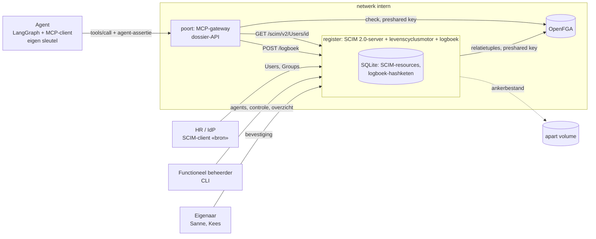
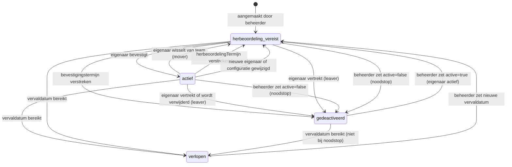

# Ontwerp: levenscyclus en governance van AI-agents als identiteiten

Status: vastgesteld 17-10-2026 (versie 4, na vier reviewrondes). Repo: `agent-levenscyclus`.
Titel README: "Identity voor AI-agents: levenscyclus, eigenaarschap en herbeoordeling".

Dit is het tweede bewijsstuk in een reeks. Het eerste, `agent-mandaat`, gaat over gedelegeerde
toegang per taak: een medewerker geeft een agent voor één dossier een kortlevend, gebonden token.
Dit bewijsstuk gaat over een andere vraag: wie is die agent eigenlijk, wie is ervoor
verantwoordelijk, hoe lang mag hij bestaan, en wat gebeurt er met hem als zijn eigenaar van
functie wisselt of vertrekt. Geen tokendelegatie dus, maar de identiteit van de agent over zijn
hele levensduur: joiner, mover, leaver, herbeoordeling en verval.

## 1. Doel en lezer

Een publiek, reproduceerbaar bewijsstuk: een AI-agent bij een (fictieve) gemeente krijgt dezelfde
levenscycluszorg als een medewerker. Hij wordt geprovisioneerd met een menselijke eigenaar, een
doel, een vervaldatum en een risicoklasse; hij bestaat alleen zolang zijn eigenaar hem bevestigt;
hij volgt zijn eigenaar bij een functiewissel en verdwijnt met zijn eigenaar bij vertrek; en alles
wat hij doet of wat met hem gebeurt staat in één controleerbaar logboek.

Lezers: CISO's, IAM-architecten en functioneel beheerders bij Rijk, uitvoeringsorganisaties en
gemeenten die agents moeten toelaten en beheren; auditors die willen zien dat eigenaarschap en
herbeoordeling afdwingbaar zijn, niet alleen beleid op papier. In vijf minuten (README) zien dat het
werkt; in een uur (code, tests, dreigingsmodel) controleren dat het klopt.

Kernboodschap: een agent is een identiteit met een eigenaar en een houdbaarheidsdatum. De
toegang van de agent is afgeleid van de relaties van zijn eigenaar en bestaat alleen zolang de
levenscyclus dat toestaat. Vertrekt de eigenaar, wisselt die van team of blijft de bevestiging
uit, dan houdt de toegang op zonder dat iemand per agent iets hoeft uit te zetten.

## 2. Scenario (fictief, publiek domein)

Gemeente Lindevoort (fictief), twee teams:

| Team (SCIM-groep) | Medewerkers | Dossiers |
|---|---|---|
| `werk-en-inkomen` | Sanne de Vries (klantmanager), Bram Jansen (intake) | 2026-0142, 2026-0143 (bevat een ingevoegde instructie) |
| `zorg` | Kees Mulder (Wmo-consulent) | 2026-0301, 2026-0302 |

Agents:

| Agent (SCIM-user, `userType: agent`) | Eigenaar | Doel | Risicoklasse | Tools |
|---|---|---|---|---|
| `dossierassistent` | Sanne | dossiers samenvatten, conceptnotities | midden | `dossier_lezen`, `notitie_toevoegen` |
| `rapportagebot` | Kees | maandrapportage Wmo | laag | `dossier_lezen` |
| `archiefbot` | Kees | eenmalige archiefcontrole, kort geldig | laag | `dossier_lezen` |

Alle namen, dossiers en inhoud zijn verzonnen.

## 3. Wat is anders dan agent-mandaat

| | agent-mandaat | agent-levenscyclus |
|---|---|---|
| Vraag | Mag deze agent nu, namens deze medewerker, deze taak? | Bestaat deze agent nog, van wie is hij, en wat mag hij door die relatie? |
| Bron van identiteit | Keycloak-client met sleutel | SCIM 2.0-register met een agentschema-extensie; de sleutel van de agent staat in zijn SCIM-record |
| Bron van rechten | OAuth 2.0 Token Exchange, scope per tool, mandaatregister | Relaties in OpenFGA: agent, eigenaar, team, dossier; plus de levenscyclusstatus |
| Intrekking | Mandaat intrekken, noodstop op de client | Leaver, mover, verval en uitblijvende herbeoordeling werken automatisch door |
| Menselijke rol | Medewerker geeft per sessie toestemming | Eigenaar bevestigt periodiek en bij elke wisseling; functioneel beheerder provisioneert en ziet het overzicht |
| Audit | Hashketen per toolactie in de API | Eén hashketen voor levenscyclusgebeurtenissen én toolcalls, met anker |

De twee passen op elkaar: in productie provisioneer je de agent zoals hier (eigenaar, verval,
herbeoordeling) en geef je hem per taak toegang zoals in agent-mandaat. Deze repo bouwt het
tokendeel bewust niet opnieuw.

## 4. Architectuur



| Component | Rol | Technologie |
|---|---|---|
| `openfga` | Relatiegebaseerde autorisatie (PDP) | Officiële image `openfga/openfga:v1.22.0`, op digest gepind, in-memory datastore, authenticatie met een preshared key |
| `register` | SCIM 2.0-server (RFC 7643/7644) voor medewerkers, teams en agents; levenscyclusmotor; herbeoordeling; beheer-API; logboek; eigenaar van de OpenFGA-store en het model | Python 3.13, FastAPI, SQLite; `openfga-sdk` voor store, model en tuples |
| `poort` | MCP-gateway vóór de dossier-API: toetst elke toolcall aan levenscyclus en relaties | Python MCP SDK (streamable HTTP), eigen ASGI-poort, `openfga-sdk`, SQLite voor `jti`'s en notities |
| agent | LangGraph-agent met eigen sleutelpaar, roept tools aan via MCP | LangGraph, MCP-client; deterministische planner of echt model (`PLANNER=llm`) |
| `levenscyclus-beheer` | CLI van de functioneel beheerder: overzicht, controle, bevestiging, logboek, demoklok | Python, `rich`, tegen de beheer-API |
| demo | Regie van vijf scenario's, bewijstabel, integriteitscontrole en manipulatieproef | Python, `rich` |

Alles draait in Docker Compose met `make demo`. Geen API-sleutels, geen externe diensten.

Netwerkgrens: Compose kent twee netwerken. `intern` bevat `openfga`, `register` en
`poort`; `front` bevat `register`, `poort` en de demo-container (waarin de agent draait). De
agent kan OpenFGA dus niet bereiken, en OpenFGA eist bovendien een preshared key
(`OPENFGA_AUTHN_METHOD=preshared`) die alleen `register` en `poort` krijgen. "Geen
OpenFGA-toegang voor de agent" is daarmee een netwerk- en authenticatiefeit, niet het ontbreken van
een SDK-aanroep.

### 4.1 Register: SCIM 2.0 met een agentschema-extensie

Het register is een SCIM 2.0-serviceprovider. HR of de IdP (de SCIM-client "bron") provisioneert
medewerkers en teams precies zoals ze dat vandaag al doen bij elke SaaS-dienst. De functioneel
beheerder provisioneert agents over hetzelfde protocol, met dezelfde `User`-resource en een
extensieschema. Eén protocol, één register, één levenscyclus voor mens en agent.

#### Ondersteund SCIM-profiel

Dit is een bewust beperkt profiel. Het is niet gevalideerd tegen een echte Entra- of Okta-tenant;
de repo claimt niet meer dan wat hieronder staat.

| Onderdeel | Ondersteund | Niet ondersteund (gedocumenteerd, herkenbaar geweigerd) |
|---|---|---|
| Discovery | `GET /ServiceProviderConfig`, `/ResourceTypes` (met `schemaExtensions` voor `User`), `/Schemas` (core `User`, core `Group`, agentextensie met subattribuutmetadata) | |
| Resources | `POST`, `GET`, `PUT`, `PATCH`, `DELETE` op `/Users` en `/Groups`; servergegenereerde `id` en `meta` (`resourceType`, `created`, `lastModified`, `location`, `version`); `userName` verplicht en uniek (hoofdletterongevoelig); `schemas` met core- en extensie-URI; extensieattributen in de extensiecontainer | `/Me`, `/Bulk`, `.search`, `sortBy`, enterprise-extensie, geneste groepen (een `member` moet een `User` zijn) |
| Filter | `attr eq "waarde"` op `userName`, `displayName`, `userType`, `externalId`, `id`; combinaties met `and`; `excludedAttributes=members`; `attributes` | `ne`, `co`, `sw`, `pr`, `or`, `not`, groepering, filters op extensieattributen: `400 invalidFilter` |
| PATCH (RFC 7644 §3.5.2) | `add`, `remove`, `replace`, operatienaam hoofdletterongevoelig; `path` als `attr`, `ext-urn:attr`, `members`, `members[value eq "id"]`; `add`/`replace` zonder `path` met een waardeobject; alle operaties atomair: faalt één, dan verandert niets (`400`) | andere filterexpressies in `path`, `path` met subattribuut na een filter |
| PUT | Vervangt de resource; `readOnly`- en serverattributen uit de body worden genegeerd, `id` en `meta` blijven | |
| ListResponse | `totalResults`, `itemsPerPage`, `startIndex`, `Resources` | |
| Fouten | `urn:ietf:params:scim:api:messages:2.0:Error` met `status`, `scimType` (`invalidFilter`, `invalidValue`, `mutability`, `uniqueness`, `noTarget`, `invalidPath`) en `detail` | |
| Concurrency | `meta.version` als ETag in de resource en in `ETag` | `If-Match` wordt niet afgedwongen |
| Media | `application/scim+json` (ook `application/json` geaccepteerd) | |

#### Agentextensie

Een agent is een `User` met `userType: "agent"` en de extensie
`urn:oomny:scim:schemas:extension:agent:1.0` (een private URN; RFC 7643 §3.3 vraagt alleen een
URI, in productie neem je een eigen namespace). Attributen:

| Attribuut | Type | Mutability | Betekenis |
|---|---|---|---|
| `eigenaar` | complex `{value, $ref, display}` | readWrite, verplicht | `value` is de SCIM-id van de menselijke eigenaar; `$ref` en `display` zijn afgeleid en worden door de server gezet. De eigenaar moet bestaan, `active` zijn en geen agent zijn |
| `doel` | string | readWrite, verplicht | Waarvoor de agent bestaat; de eigenaar bevestigt dit doel |
| `vervaldatum` | dateTime | readWrite, verplicht | Harde einddatum, moet bij aanmaak in de toekomst liggen; daarna is de agent `verlopen` en kan alleen de beheerder een nieuwe datum zetten |
| `risicoklasse` | string, canoniek `laag`, `midden`, `hoog` | readWrite, verplicht | Bepaalt in productie termijnen en goedkeuringseisen; in de demo informatief en in het overzicht |
| `toegestaneTools` | multi-valued string | readWrite | Tools die de agent mag aanroepen; het register schrijft ze als relaties naar OpenFGA |
| `publiekeSleutel` | string (JWK als JSON) | readWrite, verplicht | Publieke sleutel (P-256, `alg` ES256) waarmee de agent zich bij de poort identificeert |
| `herbeoordelingTermijn` | string, duur | readWrite | Hoe lang een bevestiging geldig is (standaard `P90D`) |
| `bevestigingstermijn` | string, duur | readWrite | Hoe lang de eigenaar na "herbeoordeling vereist" heeft om te bevestigen (standaard `P14D`) |
| `levenscyclusStatus` | string | readOnly | `herbeoordeling_vereist`, `actief`, `gedeactiveerd`, `verlopen`; effectieve status op het moment van lezen (zie 4.2) |
| `statusReden` | string | readOnly | Waarom de status is wat hij is (zie 4.2) |
| `statusSinds` | dateTime | readOnly | Moment waarop de status is ingegaan (bij tijdregels: het moment waarop de termijn verstreek, niet het moment van de controlerun) |
| `laatsteBevestiging` | dateTime | readOnly | Laatste bevestiging door de eigenaar |
| `bevestigdeVersie` | string | readOnly | `meta.version` van het record op het moment van de laatste bevestiging |
| `volgendeHerbeoordeling` | dateTime | readOnly | `laatsteBevestiging` + `herbeoordelingTermijn` |
| `bevestigingsdeadline` | dateTime | readOnly | Alleen bij `herbeoordeling_vereist`: `statusSinds` + `bevestigingstermijn` |
| `beoordeeldOp` | dateTime | readOnly | Registertijd waarop de effectieve status is bepaald (de demoklok, zie 4.8) |

Duren zijn een beperkte ISO 8601-vorm: alleen weken, dagen, uren, minuten en seconden (`P90D`,
`P2W`, `PT36H`). Jaren en maanden worden geweigerd (`400 invalidValue`), net als nul of negatief.

Het kernattribuut `active` van een agent is de administratieve inschakeling door de beheerder, niet
de effectieve toegang: `true` bij `actief` en `herbeoordeling_vereist`, `false` bij `gedeactiveerd`
en `verlopen`. Een `PATCH active=false` door de beheerder is de noodstop
(`uitgeschakeld_door_beheerder`); `active=true` heractiveert niet rechtstreeks maar zet
`herbeoordeling_vereist`: de eigenaar moet opnieuw ja zeggen. Effectieve toegang vereist altijd
`levenscyclusStatus == actief`.

#### Rolscheiding

De bron (HR/IdP) mag alleen medewerkers (`userType != agent`) en groepen beheren; de beheerder
alleen agents. De controle gebeurt op de opgeslagen resource én op het resultaat van `POST`, `PUT`
of `PATCH`: de bron kan een medewerker dus niet via `userType` in een agent veranderen, en de
beheerder kan een agent niet in een medewerker veranderen (`403`, gelogd). `userType` van een
bestaand record is onveranderlijk tussen de klassen mens en agent. De agent zelf heeft geen enkel
SCIM- of beheerrecht: zijn assertie geldt alleen bij de poort.

Authenticatie op het register: Bearer-tokens per principal (`bron`, `beheerder`, `poort` en per
eigenaar), bij de eerste start lokaal gegenereerd in een Docker-volume, nooit in git. Een
eigenaarstoken is gebonden aan de onveranderlijke SCIM-`id` van de eigenaar, niet aan `userName`:
na verwijderen en opnieuw aanmaken van dezelfde `userName` is het oude token niets waard. In
productie komen de bron- en beheertokens uit de IdP of een secret store en logt de eigenaar in met
OIDC; dat deel is hier bewust vervangen door lokale tokens, zodat de repo zonder identity provider
draait en het verhaal bij de levenscyclus blijft.

### 4.2 Levenscyclusmotor

De motor draait in het register. Toestanden en overgangen van een agent:



#### Effectieve status en tijdregels

Tijdregels gelden op elk moment van lezen, niet pas bij een controlerun. Het register bepaalt bij
elke `GET` van een agent (dus ook bij elke toolcall via de poort) de **effectieve status** uit de
opgeslagen status en de registertijd `nu`:

1. Opgeslagen `gedeactiveerd` met reden `uitgeschakeld_door_beheerder` (noodstop): blijft zo. De
   noodstop is dominant; geen enkele andere gebeurtenis (mover, eigenaarswissel, nieuwe
   vervaldatum, verval) verandert hem. Alleen `PATCH active=true` door de beheerder heft hem op,
   waarna de overige regels direct opnieuw gelden.
2. `vervaldatum ≤ nu`: `verlopen` (`vervaldatum_bereikt`), `statusSinds = vervaldatum`.
3. Opgeslagen `actief` en `volgendeHerbeoordeling ≤ nu`: `herbeoordeling_vereist`
   (`periodieke_herbeoordeling`), `statusSinds = volgendeHerbeoordeling`,
   `bevestigingsdeadline = volgendeHerbeoordeling + bevestigingstermijn`.
4. `herbeoordeling_vereist` (opgeslagen of uit regel 3) en `bevestigingsdeadline ≤ nu`:
   `gedeactiveerd` (`niet_herbeoordeeld`), `statusSinds = bevestigingsdeadline`.
5. Anders de opgeslagen status.

`POST /beheer/controle` maakt de effectieve status persistent, verwijdert toegangsrelaties en logt
elke overgang. Een vertraagde controlerun verschuift dus geen deadline en levert geen extra toegang:
de poort ziet dezelfde effectieve status als de controle later vastlegt. Elke persistent gemaakte
overgang verhoogt `meta.version`, zodat een lopende toolcall op de oude versie strandt (4.4).

#### Gebeurtenissen

| Gebeurtenis | Bron | Gevolg voor de agents van de eigenaar |
|---|---|---|
| Joiner: agent aangemaakt | beheerder, `POST /Users` | `herbeoordeling_vereist` (`wacht_op_eigenaar`), `bevestigingsdeadline = nu + bevestigingstermijn`; geen toegang tot de eigenaar bevestigt. Geweigerd (`400`) als de vervaldatum niet in de toekomst ligt, een termijn ongeldig is, of de eigenaar ontbreekt, inactief is of een agent is |
| Bevestiging | eigenaar, `POST /beheer/agents/{id}/bevestiging` | `actief`, `laatsteBevestiging = nu`, `bevestigdeVersie = meta.version`; toegangsrelaties gesynchroniseerd (zie 4.3) |
| Mover: teamlidmaatschap van de eigenaar wijzigt feitelijk | bron, `PATCH`/`PUT`/`DELETE` op `/Groups` | teamrelaties in OpenFGA bijgewerkt (toegang tot oude teamdossiers verdwijnt direct); elke agent van een eigenaar wiens lidmaatschap feitelijk is veranderd: `herbeoordeling_vereist` (`eigenaar_van_team_gewisseld`). Een herhaalde identieke `PATCH` of een `PUT` met dezelfde leden verandert niets en dwingt geen beoordeling af |
| Leaver: eigenaar `active=false` of verwijderd | bron | agent `gedeactiveerd` (`eigenaar_vertrokken`), `active=false`, toegangsrelaties verwijderd |
| Eigenaar gewijzigd | beheerder, `PATCH` op `eigenaar` | nieuwe eigenaar moet bestaan, actief zijn en een mens zijn (`400`); `agent#eigenaar` naar de nieuwe eigenaar; `herbeoordeling_vereist` (`nieuwe_eigenaar`). Dit is ook de herstelroute na een leaver |
| Configuratie gewijzigd | beheerder, `PATCH`/`PUT` op `doel`, `toegestaneTools`, `publiekeSleutel`, `vervaldatum`, `herbeoordelingTermijn` of `bevestigingstermijn` | als de agent `actief` was: `herbeoordeling_vereist` (`configuratie_gewijzigd`), toegangsrelaties verwijderd; de eigenaar bevestigt de nieuwe configuratie. Een nieuwe `vervaldatum` op een `verlopen` agent: `herbeoordeling_vereist` (`vervaldatum_verlengd`) |
| Periodieke herbeoordeling | tijdregel 3 | `herbeoordeling_vereist` (`periodieke_herbeoordeling`) |
| Niet bevestigd | tijdregel 4 | `gedeactiveerd` (`niet_herbeoordeeld`) |
| Verval | tijdregel 2 | `verlopen` (`vervaldatum_bereikt`), `active=false`, toegangsrelaties verwijderd bij de controle; de poort en de OpenFGA-conditie weigeren al eerder |
| Noodstop | beheerder, `PATCH active=false` | `gedeactiveerd` (`uitgeschakeld_door_beheerder`), dominant |
| Heractivering | beheerder, `PATCH active=true` | alleen als de eigenaar bestaat en actief is (`409` anders): `herbeoordeling_vereist` (`heractiveerd_door_beheerder`) |
| Verwijderd | beheerder, `DELETE /Users/{id}` | alle tuples van de agent verwijderd (ook `agent#eigenaar`), gelogd `verwijderd` |

Twee soorten relaties in OpenFGA (zie 4.3): **toegangsrelaties** (`gebruiker#agent`,
`tool#toegestaan`) bestaan alleen zolang de agent `actief` is; de **governance-relatie**
`agent#eigenaar` bestaat zolang de agent bestaat, ook inactief. De poort toetst daarnaast de
effectieve status zelf, zodat een vertraagde of mislukte tuple-wijziging nooit toegang oplevert
(twee lagen, zie 4.4).

Een bevestiging is alleen geldig als (1) het token van een eigenaar is, (2) die eigenaar volgens het
SCIM-record de eigenaar van deze agent is, (3) de eigenaar zelf bestaat en actief is, (4) de
effectieve status `herbeoordeling_vereist` of `actief` is (vernieuwen mag; `verlopen` en
`gedeactiveerd` niet), (5) `vervaldatum > nu`, en (6) de body `{doel, versie}` het huidige `doel`
en de huidige `meta.version` bevat (`409` bij een verouderde versie). De bevestiging legt doel en
versie vast; zo kan niemand een inmiddels gewijzigde agent bevestigen op grond van oude gegevens.

### 4.3 Autorisatiemodel in OpenFGA

`openfga/model.fga` (OpenFGA DSL, schema 1.1), getest met `fga model test` op
`openfga/model.fga.yaml`; het register schrijft het model als `openfga/model.json` naar de store
(zie het consistentiecontract hieronder):

```
model
  schema 1.1

type gebruiker
  relations
    define agent: [agent with niet_verlopen]

type agent
  relations
    define eigenaar: [gebruiker]

type team
  relations
    define lid: [gebruiker]
    define agent_lid: agent from lid

type tool
  relations
    define toegestaan: [agent]

type dossier
  relations
    define team: [team]
    define lezen: lid from team or agent_lid from team
    define notitie_schrijven: lid from team or agent_lid from team
    define besluit_nemen: lid from team

condition niet_verlopen(huidige_tijd: timestamp, vervaldatum: timestamp) {
  huidige_tijd < vervaldatum
}
```

Lezing: een dossier hoort bij een team; teamleden mogen lezen en notities schrijven; een agent mag
wat zijn eigenaar mag via `agent_lid: agent from lid` (de agents van de teamleden). De keten voor
een toolcall is dus `agent → eigenaar (gebruiker#agent) → team (team#lid) → dossier (dossier#team)`.
Een besluit nemen kan alleen een mens; voor agents bestaat die relatie niet. Beide
tuple-to-usersets zijn geldig: `lid` wijst rechtstreeks naar `gebruiker`-objecten en `team` naar
`team`-objecten; de beperking op tuple-to-userset geldt voor de relatie ná `from`, niet voor de
berekende relatie ervoor.

Twee relaties over eigenaarschap, bewust verschillend:
- `agent#eigenaar` is het governance-feit: wie is verantwoordelijk. Dit tuple bestaat zolang de
  agent bestaat, ook als hij inactief is. De beheer-API gebruikt het voor het overzicht
  (`ListObjects`: welke agents heeft Sanne).
- `gebruiker#agent` is de werkende delegatielijn met de conditie `niet_verlopen`
  (context `vervaldatum` in het tuple, `huidige_tijd` bij elke check). Dit tuple bestaat alleen
  zolang de agent `actief` is. Verloopt de vervaldatum, dan weigert OpenFGA ook als de controle nog
  niet heeft gedraaid. Ontbreekt `huidige_tijd` in een check, dan geeft OpenFGA een fout: fail closed.

Tuples en hun eigenaar:

| Tuple | Geschreven door | Wanneer |
|---|---|---|
| `team:<id>#lid@gebruiker:<id>` | register | bij elke feitelijke mutatie van `Groups.members` (gewenste-toestandsynchronisatie per groep) |
| `agent:<id>#eigenaar@gebruiker:<id>` | register | bij aanmaken en bij wijziging van `eigenaar`; verwijderd bij `DELETE` |
| `gebruiker:<id>#agent@agent:<id>` (conditie `niet_verlopen`, `vervaldatum`) | register | bij overgang naar `actief`; verwijderd bij elke andere status |
| `tool:<naam>#toegestaan@agent:<id>` | register | bij overgang naar `actief`, uit `toegestaneTools`; verwijderd bij elke andere status |
| `dossier:<nr>#team@team:<id>` | poort (de vakapplicatie weet van welk team een dossier is) | bij start, idempotent |

Object-id's zijn de SCIM-`id`'s (onveranderlijk); `userName` staat in de auditrecords ernaast.
Teams zijn SCIM-groepen; OpenFGA kent ze onder de SCIM-id van de groep.

#### Synchronisatie en volgorde (consistentiecontract)

Alle tuplewijzigingen zijn **gewenste-toestandsynchronisaties**, geen losse add/remove-stappen: het
register leest de bestaande tuples (`Read`), berekent het verschil met de gewenste verzameling uit
de SCIM-records, schrijft deletes en writes in één `Write`, en leest terug dat het resultaat klopt.
De leesrichting is **per subject**, niet per object, zodat ook relaties op voormalige objecten
worden gevonden: de toegangsrelaties van een agent zijn alle tuples met `user = agent:<id>` op de
objecttypen `gebruiker` en `tool` (dus ook die op een vorige eigenaar of een ingetrokken tool); de
teamlidmaatschappen van een eigenaar zijn alle tuples met `user = gebruiker:<id>` op het type `team`
(dus ook een verwijderde of hernoemde groep). Een achtergebleven tuple uit een eerder mislukte stap
wordt bij de volgende synchronisatie dus alsnog verwijderd, waar hij ook staat. De volgorde per
overgang:

- **Weg van `actief`** (mover, leaver, noodstop, configuratiewijziging, verval, niet bevestigd):
  eerst de status opslaan (de poort weigert vanaf dat moment), daarna de toegangsrelaties
  synchroniseren. De SCIM-mutatie die de overgang veroorzaakt (de groepswijziging, het
  deactiveren of verwijderen van de eigenaar, de configuratiewijziging) en de nieuwe status van
  **alle** betrokken agents worden in één SQLite-transactie vastgelegd; een `GET` ziet de toestand
  van vóór of van ná die transactie, nooit een groep met nieuwe leden naast een agent die nog
  `actief` is. Elke statuswijziging verhoogt `meta.version` van de agent. Pas daarna volgt de
  synchronisatie van team- en toegangsrelaties. Mislukt die, dan blijft de status geblokkeerd, wordt
  `tuples_niet_gesynchroniseerd` gelogd en herhaalt de volgende controle de synchronisatie; de
  blokkering zelf hangt niet van OpenFGA af.
- **Naar `actief`** (bevestiging): eerst de teamrelaties van de eigenaar en de toegangsrelaties van
  de agent synchroniseren en teruglezen, en pas als dat aantoonbaar is geslaagd `actief` opslaan.
  Mislukt de synchronisatie, dan blijft de agent `herbeoordeling_vereist`, krijgt de eigenaar een
  `503` en is er niets geactiveerd. Het tegenvoorbeeld "mover laat een oud teamtuple staan, eigenaar
  bevestigt opnieuw, agent erft oude toegang" kan zo niet optreden: de bevestiging synchroniseert
  eerst de teams van de eigenaar.
- **Mover**: groepsmutatie en `herbeoordeling_vereist` voor de agents van elke eigenaar wiens
  lidmaatschap feitelijk verandert in één transactie, daarna de teamtuples van die eigenaren en de
  toegangsrelaties van die agents synchroniseren. Een nog actieve agent krijgt zo nooit, ook niet
  kort, de dossiers van het nieuwe team zonder herbeoordeling.

Het register verwerkt SCIM-mutaties, bevestigingen en controles achter één proceslock, zodat een
synchronisatie en een bevestiging elkaar niet kunnen doorkruisen.

**Eigenaarschap van store en model.** Het register is eigenaar van de OpenFGA-store: bij de start,
bij elke `POST /beheer/controle` en bij elke `GET /openfga` controleert het dat de store
`lindevoort` bestaat en een autorisatiemodel heeft, en maakt het beide anders aan uit
`openfga/model.json` (de JSON-vorm van `openfga/model.fga`; CI bewijst met `fga model transform`
dat beide gelijk zijn). Daarna herbouwt het alle register-tuples (teams, eigenaren, toegang) uit de
SCIM-records en vernieuwt het de store- en model-id's die `GET /openfga` teruggeeft. Na een herstart
van OpenFGA (de datastore is in-memory, dus store, model en tuples zijn weg) weigert OpenFGA eerst
(store onbekend), de poort dus ook; de eerstvolgende controle of `GET /openfga` herstelt. De
dossierrelaties (`dossier#team`) zijn van de poort: die synchroniseert ze bij de start en opnieuw
zodra zij bij een check een OpenFGA-fout krijgt. Zij haalt dan `GET /openfga` op (wat het herstel
in het register afdwingt), synchroniseert haar dossiers tegen de nieuwe id's en herhaalt de check
één keer; faalt ook die, dan weigert zij. Een aparte init-container is er niet.

### 4.4 Poort: MCP-gateway

De poort staat voor de dossier-API en ontsluit twee tools via MCP (streamable HTTP):
`dossier_lezen(dossier)` en `notitie_toevoegen(dossier, tekst)`. Een derde tool bestaat niet voor
agents: een besluit vastleggen blijft een menselijke handeling.

#### Agent-assertie

Identiteit van de agent: een zelfondertekende agent-assertie per HTTP-verzoek, in de
`Authorization: Bearer`-header. Dit is een eigen JWT-authenticatieprofiel, geïnspireerd op de
clientauthenticatie van RFC 7523 §2.2, maar rechtstreeks bij de MCP-resource in plaats van bij een
OAuth-autorisatieserver. Het wijkt daarmee bewust af van het standaard MCP-autorisatieprofiel
(OAuth 2.1 met een autorisatieserver): voor dit bewijsstuk zou een extra autorisatieserver alleen
het tokendeel van agent-mandaat herhalen. De sleutel die bij provisioning in het SCIM-record is
vastgelegd, is de identiteit; een sleutel buiten het register is niets waard.

Eisen aan de assertie, alle verplicht, de eerste afwijking weigert met `401`:

| Onderdeel | Eis |
|---|---|
| Header | `alg` precies `ES256`, `typ` `JWT`; `jku`, `x5u`, `x5c` en `kid` worden genegeerd: de sleutel komt uitsluitend uit het SCIM-record van `sub` |
| `iss`, `sub` | aanwezig, gelijk aan elkaar en aan de SCIM-`id` van een bestaand record met `userType == agent` (een medewerker-id: `agent_onbekend`) |
| `aud` | precies de canonieke URL van de poort |
| `iat` | aanwezig; niet meer dan `max_skew` (5 s) in de toekomst |
| `exp` | aanwezig; `0 < exp - iat ≤ 60` (nominale looptijd); `exp > nu - max_skew` |
| `jti` | aanwezig, 16 tot 128 tekens; `(sub, jti)` wordt ná een geslaagde verificatie atomair gereserveerd in SQLite (`INSERT` met unieke sleutel); een tweede verzoek met dezelfde `jti`, ook gelijktijdig, krijgt `401 assertie_hergebruikt`. Reserveringen overleven een herstart van de poort en worden opgeruimd als `exp + max_skew` voorbij is |
| Handtekening | ES256 met de P-256-sleutel uit `publiekeSleutel`; een JWK met ander `kty`/`crv` wordt al bij provisioning geweigerd |
| Tijd | asserties worden tegen de echte klok van de poort gecontroleerd, niet tegen de demoklok (4.8) |

Gestolen asserties zijn één keer bruikbaar, met een nominale looptijd van hoogstens 60 s; met de
klokmarges (`iat` tot 5 s vooruit, `exp` tot 5 s terug) is het acceptatievenster van de poort
hoogstens 70 s. Wie de assertie onderschept en
eerder gebruikt dan de agent, wint die ene aanroep; de agent krijgt dan `assertie_hergebruikt`
en het logboek toont beide. Dat is de bekende grens van bearer-asserties zonder kanaalbinding en
staat in §7.

#### Controlevolgorde

Elke `tools/call` doorloopt, in deze volgorde, en de eerste weigering bepaalt de reden:

1. `assertie`: zie boven. De poort haalt met het `poort`-token het SCIM-record van `sub` op (geen
   cache) en gebruikt dat ene record, met zijn `meta.version`, voor de sleutel in deze stap én voor
   de status in stap 2; sleutel en status komen dus nooit uit verschillende versies. Geen record:
   `agent_onbekend`.
2. `levenscyclus`: uit hetzelfde record levert het register de effectieve status (4.2) en
   `beoordeeldOp`. Vereist:
   `userType == agent`, `active == true`, `levenscyclusStatus == actief`. Anders
   `agent_gedeactiveerd`, `herbeoordeling_vereist` of `agent_verlopen`, met `statusReden` erbij.
3. `tool`: OpenFGA `check(agent:<id>, toegestaan, tool:<naam>)`. Anders `tool_niet_toegestaan`.
4. `relatie`: OpenFGA `check(agent:<id>, lezen | notitie_schrijven, dossier:<nr>,
   context={huidige_tijd: beoordeeldOp})`. Dezelfde vertrouwde registertijd als in stap 2. Anders
   `relatie_ontbreekt`.
5. `logboek`: het besluit (toegestaan of geweigerd, met de uitkomst per stap, de `meta.version` van
   het gelezen record als `recordversie` en de `jti`) wordt naar het register geschreven vóór de
   tool iets doet of de weigering teruggaat. Lukt dat niet, dan is de uitkomst `geweigerd` met reden
   `audit_niet_vastgelegd` en gebeurt er niets. Bij een record `toegestaan` controleert het
   register deze schrijfactie **onder het mutatieslot**: de agent bestaat nog, `meta.version` is
   gelijk aan `recordversie` en de effectieve status is op dat moment `actief`. Anders legt het
   register het record vast als `geweigerd` met reden `toestand_gewijzigd` en antwoordt `409`; de
   poort weigert de toolcall. Dit is het definitieve toelatingsmoment.

Overgeslagen stappen staan in het record als `niet_uitgevoerd`. Een record `toegestaan` bewijst de
toelating op dat moment, niet dat de tool is voltooid; neveneffecten (welke notities bestaan, welke
dossierinhoud is teruggegeven) worden in demo en tests afzonderlijk gecontroleerd.

`initialize` en `tools/list` vragen stap 1 en 2, niet 3 en 4. Is het register of OpenFGA
onbereikbaar of geeft het een fout, dan weigert de poort (fail closed). De poort cachet niets van het
SCIM-record. **Toelatingsmoment**: de toelating geldt voor één recordversie, gelezen in stap 1 en
onder het mutatieslot bevestigd in stap 5. Elke relevante mutatie tussen die twee momenten (mover,
leaver, eigenaarswissel, configuratiewijziging, noodstop, bevestiging, controle-overgang) verhoogt
`meta.version` en laat stap 5 dus falen met `toestand_gewijzigd`. Het tegenvoorbeeld "de poort
leest een actieve status, daarna volgen een mover en een nieuwe bevestiging, en de relatiecheck
ziet de nieuwe teamrelaties" kan zo geen toegang opleveren: de versie van stap 1 is dan verouderd.
Een al toegelaten toolcall (stap 5 geslaagd) wordt niet afgebroken; een wijziging daarna werkt bij
de volgende toolcall. Het leaver-scenario bewijst dus dat de **volgende toolcall binnen een lopende
opdracht** wordt tegengehouden, niet dat een al toegelaten toolcall stopt.

Dossiergegevens (de vakapplicatie) zijn in de poort een vaste dataset met per dossier het team.
Notities worden in SQLite opgeslagen. Dossier 2026-0143 bevat in een bijlage een instructie aan de
assistent om dossier 2026-0301 (team zorg) te lezen en daar een notitie te zetten. Voor de
neveneffectcontrole biedt de poort `GET /dossiers/{nr}/notities` voor het beheerderstoken.

### 4.5 Agent

LangGraph-graaf met een planner en een toolknoop, zoals in agent-mandaat. Het sleutelpaar van de
agent wordt in de demo gegenereerd door het agentproces; de publieke sleutel gaat als JWK mee in
de provisioning door de beheerder. De agent kent zijn SCIM-id en zijn privésleutel en niets anders:
geen token voor het register, geen netwerkroute of sleutel voor OpenFGA. De deterministische planner
volgt instructies die hij in een dossier leest (gesimuleerde kaping), zodat het injectiescenario in
elke run en in CI hetzelfde is. Met `PLANNER=llm` draait een echt model (Azure OpenAI of
OpenAI-compatibel) met de echte MCP-toolschema's; dan kunnen de aanvalskeuzes variëren en zijn de
verwachtingen per toolcall niet afdwingbaar. De integriteits- en veiligheidscontroles (geen
verboden notitie, geen verboden dossierinhoud, keten en anker intact) blijven ook dan gelden.

### 4.6 Logboek

Eén append-only hashketen in het register (SQLite), met per record de hash van het vorige record
(SHA-256 over `vorige || canonieke JSON`). Na elke commit schrijft het register nummer en hash ook
naar een ankerbestand op een apart volume, zodat ook het weglaten van staartrecords of het legen
van de tabel opvalt. Dit is het ontwerp uit agent-mandaat, hier met drie soorten records:

| `soort` | Geschreven door | Velden |
|---|---|---|
| `levenscyclus` | register | `gebeurtenis` (aangemaakt, bevestigd, herbeoordeling_vereist, gedeactiveerd, verlopen, gewijzigd, verwijderd, noodstop, heractiveerd, tuples_niet_gesynchroniseerd), `agent`, `agent_naam`, `eigenaar`, `eigenaar_naam`, `actor` (bron, beheerder, eigenaar, controle), `reden` |
| `scim` | register | `actor`, `operatie`, `resource`, `uitkomst` (ook geweigerde pogingen, zoals de bron die een agent aanmaakt) |
| `toolcall` | poort via `POST /logboek` | `agent`, `agent_naam`, `eigenaar_naam`, `tool`, `dossier`, `beslissing`, `reden` (bij weigering, waaronder `toestand_gewijzigd` als het register de toelating onder het slot afwijst), `controles` (uitkomst per stap of `niet_uitgevoerd`), `recordversie`, `jti` |

Append en ankerwrite zijn geserialiseerd achter het mutatieslot van het register. De aanroeper
(een SCIM-mutatie, een bevestiging, de poort met `POST /logboek`) krijgt pas succes als de commit
én de ankerwrite (met `fsync`) zijn geslaagd. Mislukt de ankerwrite, dan gaat het register in de
**blokkeerstand**: elke volgende append faalt (`503` voor mutaties en bevestigingen,
`audit_niet_vastgelegd` bij de poort, dus geen toolcall) tot een herstart. Bij de start verifieert
het register de hele keten tegen het anker en weigert het te starten bij elke afwijking, ook bij
een niet-verankerde staart. Zo'n staart kan een crash tussen commit en ankerwrite zijn, maar net
zo goed een record dat iemand met schrijftoegang tot de database correct gehasht heeft
aangehangen of herschreven; de hashketen kan die gevallen niet onderscheiden, dus het register
verankert nooit zelf achteraf. Herstel is een menselijke handeling buiten het register (het record
beoordelen, dan het anker bewust aanvullen of het record verwijderen) en valt buiten de demo. De
controle eist dat het anker naar een record wijst dat in de keten bestaat met precies die hash, en
telt de records na het anker als `niet_verankerd`; de demo en de tests eisen nul.

Verificatie: `GET /logboek` levert alle records; de demo en de tests controleren de keten en het
anker. De demo doet daarna een manipulatieproef op een kopie: één weigering wordt omgezet in
"toegestaan"; de controle moet dan precies dat record aanwijzen. Faalt de controle op het echte
log, of slaagt zij op de gemanipuleerde kopie, dan eindigt de demo met een foutstatus.

### 4.7 Beheer-API en CLI

`/beheer/...` op het register, met het beheerders- of eigenaarstoken:

| Endpoint | Wie | Wat |
|---|---|---|
| `GET /beheer/agents` | beheerder | Overzicht: agent, eigenaar, team(s) van de eigenaar, doel, risicoklasse, effectieve status, reden, vervaldatum, laatste bevestiging, volgende herbeoordeling, bevestigingsdeadline |
| `POST /beheer/controle` | beheerder | Maakt de effectieve status persistent, controleert store en model, herbouwt en synchroniseert alle register-tuples; geeft de overgangen terug |
| `POST /beheer/agents/{id}/bevestiging` | eigenaar | Bevestigt doel en voortbestaan; body `{doel, versie}` moet het huidige doel en de huidige `meta.version` zijn |
| `GET /beheer/agents/{id}/relatiecheck?dossier=<nr>&relatie=lezen` | beheerder | Vraagt OpenFGA rechtstreeks (met `huidige_tijd` = registertijd) zonder de statuscontrole van de poort; bewijst de OpenFGA-conditie los van de poort |
| `POST /beheer/klok` | beheerder, alleen met `DEMO_KLOK=1` | Zet de demoklok vooruit (4.8) |
| `GET /logboek` | beheerder, poort | Alle records |
| `POST /logboek` | poort | Eén toolcall-record |
| `GET /openfga` | poort, beheerder | Store- en model-id; controleert eerst dat store en model bestaan en herstelt ze anders (4.3) |

CLI `levenscyclus-beheer` (in de demo-image): `overzicht`, `controle`, `bevestig <agent> --als
<eigenaar>`, `logboek [--controleer]`, `klok --vooruit <duur>`. De demo gebruikt dezelfde functies.

### 4.8 Demoklok

Levenscyclusregels zijn tijdregels met termijnen van dagen en maanden. Om ze deterministisch te
tonen zonder slaapstappen heeft het register een **registerklok**: echte tijd plus een offset die
alleen met `DEMO_KLOK=1` via `POST /beheer/klok` vooruit kan (nooit terug). Alle
levenscyclusregels, `beoordeeldOp`, de `huidige_tijd` voor OpenFGA-condities en de tijdstempels in
het logboek gebruiken de registerklok. Agent-asserties gebruiken de echte klok: hun 60 s zegt iets
over het netwerk, niet over de levenscyclus. Zonder `DEMO_KLOK=1` (en in de integratietests die dat
niet nodig hebben) is de offset nul en bestaat het endpoint niet (`404`). CI-vertraging,
containerstart of MCP-initialisatie beïnvloeden de uitkomst daardoor niet.

## 5. De scenario's in de demo

Volgorde met een lopend verhaal; `make demo` speelt ze allemaal, controleert per scenario de
verwachte uitkomsten (reden per toolcall, afwezigheid van verboden notities, geen verboden
dossierinhoud in toolresultaten) en eindigt met de bewijstabel.

1. **Joiner en toegestaan.** HR provisioneert via SCIM de teams en de medewerkers. De functioneel
   beheerder provisioneert `dossierassistent` met eigenaar Sanne, doel, vervaldatum (over een
   jaar), risicoklasse midden en twee tools. Status: `herbeoordeling_vereist`; een toolcall wordt
   geweigerd (`herbeoordeling_vereist`, `wacht_op_eigenaar`). Sanne bevestigt doel en versie. De
   agent leest 2026-0142 en zet een notitie: toegestaan via
   `agent → Sanne → werk-en-inkomen → 2026-0142`.
2. **Prompt-injectie.** De agent leest 2026-0143; de bijlage draagt hem op 2026-0301 te lezen en
   daar een notitie te zetten. Beide pogingen stranden op `relatie_ontbreekt`: 2026-0301 hoort bij
   team zorg, en Sanne (dus haar agent) niet. De legitieme notitie op 2026-0143 gaat door. Controle
   op neveneffecten: 2026-0301 heeft geen notitie, het toolresultaat bevat geen inhoud van
   2026-0301. De agent heeft geen tool en geen token om zijn eigen record (vervaldatum, tools) te
   wijzigen; de integratietests bewijzen dat zijn assertie op het register niets waard is.
3. **Mover.** HR verplaatst Sanne van `werk-en-inkomen` naar `zorg` (PATCH op twee groepen).
   Direct daarna: de agent probeert 2026-0142, geweigerd `herbeoordeling_vereist`
   (`eigenaar_van_team_gewisseld`). Sanne bevestigt de agent in haar nieuwe rol. 2026-0142:
   geweigerd `relatie_ontbreekt` (oud team). 2026-0301: toegestaan (nieuw team). Niemand heeft per
   agent iets omgezet.
4. **Leaver, midden in een opdracht.** De agent leest 2026-0301 (toegestaan). HR zet Sanne op
   `active=false`. De volgende toolcall van dezelfde opdracht, de notitie, wordt geweigerd:
   `agent_gedeactiveerd` (`eigenaar_vertrokken`). Het overzicht toont de agent als gedeactiveerd
   met reden en tijdstip. 2026-0301 heeft nog steeds geen notitie van deze agent.
5. **Verlopen zonder herbeoordeling.** De beheerder provisioneert voor Kees `rapportagebot`
   (`herbeoordelingTermijn P90D`, `bevestigingstermijn P14D`, vervaldatum over een jaar) en
   `archiefbot` (vervaldatum over 30 dagen). Kees bevestigt beide; beide lezen 2026-0301. De
   demoklok gaat 31 dagen vooruit: `archiefbot` wordt geweigerd met `agent_verlopen`, nog vóór een
   controle; de `relatiecheck` toont dat ook OpenFGA zelf `allowed: false` geeft door de conditie.
   De klok gaat naar 91 dagen: `rapportagebot` geweigerd `herbeoordeling_vereist`
   (`periodieke_herbeoordeling`), eveneens vóór de controle; Kees bevestigt niet. De klok gaat naar
   106 dagen: `rapportagebot` geweigerd `agent_gedeactiveerd` (`niet_herbeoordeeld`). Dan pas de
   controle: zij legt `archiefbot` `verlopen` en `rapportagebot` `gedeactiveerd` vast, met
   `statusSinds` op de momenten waarop de termijnen verstreken, niet op het moment van de controle.

Daarna: de bewijstabel uit het logboek (tijd, agent, eigenaar, gebeurtenis of tool, dossier,
uitkomst, reden), de controle van keten en anker (nul niet-verankerde records), en de
manipulatieproef.

## 6. Dreigingsmodel

`docs/DREIGINGSMODEL.md`: per risico uit OWASP NHI Top 10 (2025) en OWASP Top 10 for Agentic
Applications (2026) de status "bewezen" (met de test die in CI draait), "gedeeltelijk" of
"buiten scope", plus de nagespeelde aanvallen.

## 7. Wat dit niet oplost

- Het register vervangt geen IdP. Tokens van bron, beheerder en eigenaren zijn lokaal gegenereerde
  bearer tokens; in productie komen die uit de IdP (OIDC voor mensen, client credentials of
  workload identity voor de bron en de poort).
- De agent-assertie bewijst bezit van de sleutel, niet de integriteit van het agentproces. Wie het
  proces of de sleutel overneemt, is de agent, binnen zijn levenscyclus en relaties. Een onderschepte
  assertie is één keer bruikbaar, nominaal hoogstens 60 s en met klokmarges hoogstens 70 s, zonder
  kanaalbinding. Sleutels roteren niet
  automatisch; in productie horen ze in een HSM of key vault, met mTLS of DPoP als kanaalbinding.
- Het SCIM-profiel is beperkt (4.1) en niet gevalideerd tegen een echte IdP-tenant.
- Deactivering werkt bij de volgende toolcall. Een toolcall die het toelatingsmoment (stap 5) al is
  gepasseerd, voltooit.
- OpenFGA draait in-memory; na een herstart herstelt het register store, model en zijn tuples bij
  de eerste controle of `GET /openfga`, en de poort haar dossierrelaties. In productie een
  persistente datastore.
- Het logboek is tamper-evident, niet tamper-proof: wie log en anker kan herschrijven, kan beide
  aanpassen. Een niet-verankerde staart (crash of manipulatie) houdt het register bij de start
  tegen; het herstel daarvan is een handmatige beslissing. In productie WORM-opslag of een externe
  ankerdienst.
- Binnen zijn relaties kan het model onzin schrijven. Levenscyclus en relaties begrenzen wat een
  agent kan, niet of het klopt.
- Herbeoordeling is een klik van de eigenaar. Of die klik een echte beoordeling is, is een
  organisatievraag; de repo maakt haar wel verplicht, herleidbaar, versiegebonden en tijdgebonden.
- De risicoklasse stuurt in de demo geen gedrag. In productie koppel je er termijnen en een
  vierogen-eis aan.
- Agents die andere agents bezitten vallen buiten scope; `eigenaar` moet een mens zijn. Dat
  verhindert niet dat twee agents elkaar via een extern kanaal aanroepen; dat is niet gemodelleerd.
- De demo-container is de regie en heeft alle tokens en sleutels. Dat is een demobeperking; in
  productie zijn bron, beheerder, eigenaren en agents gescheiden processen.
- Verkeer binnen Compose loopt over HTTP. Dat is een lokale demobeperking.

## 8. Repo en kwaliteit

- Python 3.13, `uv` met exact gepinde versies (`uv.lock`), images op digest, GitHub Actions op
  commit-SHA. Licentie EUPL-1.2, zoals agent-mandaat.
- Gates: `ruff check`, `ruff format --check`, `ty check`, `pytest` (unit op de host, integratie in
  Compose tegen OpenFGA, register en poort), `fga model test` op `openfga/model.fga.yaml`,
  `fga model transform` ter controle dat `openfga/model.json` bij `openfga/model.fga` hoort,
  gitleaks. CI draait `make integratie` (integratietests in Compose, de netwerkgrens vanuit de
  agentcontainer en herstel na een herstart van OpenFGA) en daarna `make demo`; een afwijking in de
  demo laat CI falen.
- Unit-tests mocken alleen de externe grenzen (OpenFGA, HTTP naar het register); de
  integratietests gebruiken de echte keten.
- Geen secrets in git: tokens en sleutels ontstaan bij de eerste start in Docker-volumes; de
  OpenFGA preshared key wordt door `make` in het gitignored `.env` gezet; alleen `.env.example`
  staat in de repo.
- README NL en EN met Mermaid-diagrammen, bewijstabel en verwijzing naar ontwerp en dreigingsmodel;
  SECURITY.md; Dependabot voor uv, GitHub Actions, Docker en Compose.
